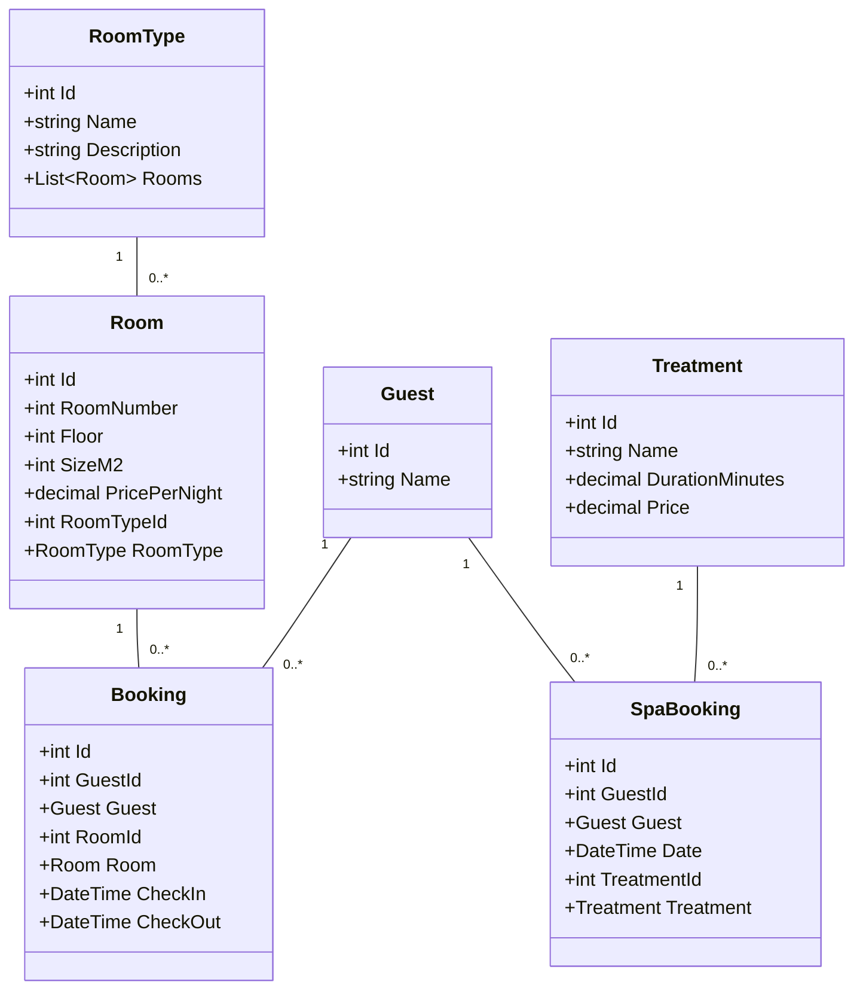

# Hotel Grandioso — Inlämning 1

**Namn:** Emma Löwing

## Så kör du projektet

1. Forka repot på GitHub och klona din fork
2. Öppna `HotelGrandioso.slnx` i Visual Studio (eller öppna mappen i VS Code)
3. Tryck **F5** för att starta

Via terminalen:

```bash
dotnet run --project HotelGrandioso
```
## Databas

Projektet använder SQLite som databas och Entity Framework Core med Code First.

Jag har skapat entiteterna i C# och använt migrationer för att skapa motsvarande tabeller i databasen.

Databasanslutningen anges genom miljövariabeln `HOTEL_DB`.

För att ange anslutningssträngen i PowerShell:

```powershell
$env:HOTEL_DB = "Data Source=hotel.db"
```

För att skapa eller uppdatera databasen med befintliga migrationer kan man använda Package Manager Console i Visual Studio:

```powershell
Update-Database
```

Databasen innehåller information om rum, rumstyper, gäster, rumsbokningar, behandlingar och spabokningar.

- **Databas:** SQLite.
- **Migrationer:** Jag använder Entity Framework Core Code First. Jag skapar migrationer i Visual Studios Package Manager Console med `Add-Migration InitialCreate` och kör dem med `Update-Database`. Innan kommandona körs anger jag databasanslutningen med `$env:HOTEL_DB = "Data Source=hotel.db"`.


## Seeding

Jag har skapat klassen `HotelSeeder` för att lägga in hotellets rum, rumstyper och spabehandlingar i databasen.

Jag använder seeding för att slippa lägga in all information manuellt varje gång jag skapar en ny databas.

Jag använder också `Any()` för att kontrollera om informationen redan finns, så att samma rum och behandlingar inte läggs till flera gånger när programmet startas.


## UML-klassdiagram



## GDPR

Utvärdera fälten i `Guest` ett i taget. Vad bygger du in, och varför?
När jag skapade entiteten Guest valde jag att bara spara Id och Name. Jag utgick ifrån att systemet inte ska samla in fler personuppgifter än vad som behövs för att kunna hantera bokningarna.

**Id:** Jag använder ett unikt ID för att kunna skilja gäster åt, även om två gäster har samma namn.
**Name** Jag sparar gästens namn för att kunna se vem som har gjort en bokning.
**HariColor:** Jag valde att inte spara hårfärg eftersom det inte behövs för att boka ett hotellrum eller en spabehandling.
**HeightCM:** Jag valde att inte spara lägnd eftersom det inte är relevant för bokningssystemet.
**Religion:** Jag valde att inte spara religion eftersom det inte behövs för bokningen. Religion är dessutom en känslig personuppgift enligt GDPR.

Mitt mål har varit att följa principen om dataminimering, alltså att bara samla in de personuppgifter som behövs för systemets syfte.

>
## Designmönster

Jag har använt Repository-mönstret genom att skapa klassen `HotelRepository`.

`HotelRepository` ansvarar för att hämta, skapa och ta bort information i databasen, exempelvis bokningar och rum.

Jag valde att separera databasarbetet från resten av programmet för att göra koden tydligare och lättare att underhålla. På så sätt behöver jag inte skriva databasfrågor direkt i `Program.cs` eller `BookingService.cs`.

>

## Tekniker

- C# / .NET 10
- Entity Framework Core
